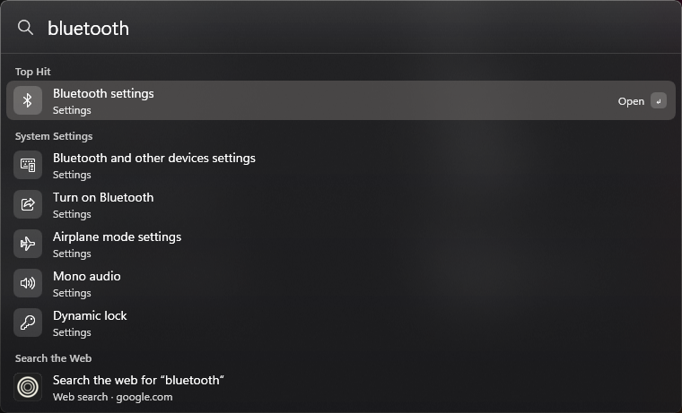

# Spotlight for Windows

A fast, macOS-style Spotlight search for Windows 11 and 10. Press **Win+Space**, type, press **Enter**.



## Features

- **Apps** – every app in the Start menu, classic programs and Store apps
- **Windows Settings and Control Panel** – over 1,000 entries from Windows' own settings index, always in your Windows display language
- **Files and folders** – Desktop, Documents, Downloads, Pictures, Music, Videos and OneDrive, plus documents found by their content (Windows Search index)
- **Bookmarks** – Chrome, Edge, Brave, Vivaldi, Opera, Firefox, Zen, Floorp, LibreWolf, Waterfox
- **Calculator, units and currencies** – `2(3+4)`, `15% of 80`, `sqrt 2`, `10 km`, `100 °F`, `3 cups in ml`, `100 usd in eur` (daily ECB rates)
- **System commands** – lock, sleep, shut down, restart, sign out, empty recycle bin (destructive ones ask for a second Enter)
- **Websites, paths and the web** – `github.com` opens directly, `C:\Us` + Tab completes paths, anything else can be searched on the web
- **Recent** – the last 5 things you opened, shown while the search box is empty
- **Learns** – what you pick for a query ranks first the next time
- **Frosted glass** – follows light/dark mode and your accent colour
- **27 languages** – the interface follows the Windows display language
- **Always ready** – starts with Windows, lives in the tray, no administrator rights needed

## Download and install

1. **[Download Spotlight-win-x64.exe](https://github.com/LeoAppleCool/spotlight-for-windows/releases/latest/download/Spotlight-win-x64.exe)** (all versions: [Releases](https://github.com/LeoAppleCool/spotlight-for-windows/releases)).
2. Run it. The app isn't code-signed, so Windows SmartScreen may warn: click **More info → Run anyway**.
3. Spotlight installs itself for your user account (`%LOCALAPPDATA%\Programs\Spotlight`), adds a Start menu entry and starts with Windows from now on. Press **Win+Space**.

No .NET installation is needed. Runs on 64-bit Windows 10/11 (ARM devices run it through Windows' x64 emulation).

## Keys

| Key | Action |
| --- | --- |
| Win+Space | Open / close Spotlight |
| ↑ ↓ | Select a result |
| Enter | Open (calculations: copy the result) |
| Ctrl+Enter | Show in folder |
| Ctrl+Shift+Enter | Run as administrator |
| Tab | Complete a path |
| Ctrl+C | Copy the path, link or result |
| Delete | Remove the selected item from Recent |
| Esc | Clear the search, press again to close |

## Good to know

- Win+Space normally switches the keyboard language. Spotlight takes the shortcut over; use the language switcher in the taskbar (or Alt+Shift) instead.
- While an app running as administrator or a virtual machine has the focus, Windows doesn't let Win+Space through to Spotlight.
- Settings live in `%LOCALAPPDATA%\Spotlight\config.json`: web search URL, extra folders to index, excluded folder names, content search, autostart.
- Everything is searched locally. The only network request downloads the ECB exchange rates (at most every 12 hours, and only when you convert currencies).

## Uninstall

Settings › Apps › Installed apps › **Spotlight** › Uninstall – or run `Spotlight.exe --uninstall`.

## Build from source

Requires the [.NET 10 SDK](https://dotnet.microsoft.com/download).

```powershell
dotnet run --project tests/Spotlight.Tests            # tests
powershell -ExecutionPolicy Bypass -File scripts\install.ps1   # build and install for the current user
```

`Spotlight.exe --query "text" --out results.txt` writes the ranked results of a query without showing any UI.

---

Spotlight is a trademark of Apple Inc. This project is not affiliated with or endorsed by Apple.
